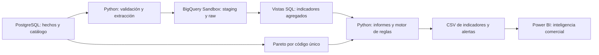

# Retail Intelligence | Data Engineering + BI + reglas comerciales

**Portafolio técnico — PostgreSQL · Python · Google BigQuery · Power BI**

## Problema de negocio
¿Cómo identificar productos prioritarios, monitorear abonos y traducir información transaccional en recomendaciones comerciales verificables? Este proyecto demuestra un flujo de datos desde la preparación y conciliación hasta el análisis y la visualización ejecutiva.

> **Datos históricos 2009–2011:** utilizados para demostrar metodología, no para inferir la demanda vigente. No representa una implementación corporativa en producción.

## Arquitectura

La automatización de carga utiliza **Windows Task Scheduler** en un equipo local, no un servicio en la nube permanentemente encendido. BigQuery Sandbox requiere un método de reemplazo mediante *copy job* en lugar de `MERGE` DML.

## Resultados del corte histórico

| Indicador | Resultado |
|---|---:|
| Ventas brutas | GBP 19.643.861,64 |
| Abonos | GBP -716.462,57 |
| Ventas netas | GBP 18.927.399,07 |
| Facturas | 39.516 |
| Unidades | 11.188.061 |
| Tasa de abonos | 3,65 % |
| Productos ABC (códigos con neto positivo) | 4.705 |
| Categoría A | 1.038 códigos, 80,01 % de la base positiva |
| Alertas deterministas V17 | 4 |

**Conciliación:** la base ABC de GBP 18.927.963,33 incluye únicamente códigos con ventas netas positivas; por ello difiere en GBP 564,26 de las ventas netas globales. Se consolidaron 170 filas adicionales asociadas a códigos repetidos; **no equivalen a 170 códigos duplicados**.

## Reglas y hallazgos

- **Concentración ABC:** priorizar revisión de margen y disponibilidad de los productos A, sin recomendar compras automáticas.
- **Abonos, artículo 22423:** 5,00 % frente al 3,65 % general; investigar motivos antes de inferir defectos o causalidad.
- **Comparabilidad temporal:** diciembre de 2011 es parcial, por lo que no debe compararse como mes completo.
- **Granularidad:** agrupar por código antes de clasificar ABC y conservar trazabilidad.

Las recomendaciones provienen de **reglas deterministas**. Claude API es un componente **opcional**; no se ha usado para generar estas conclusiones.

## Entregables y estado

| Etapa | Tecnologías | Estado documentado |
|---|---|---|
| 01 | PostgreSQL, SQL, Power BI | Transformaciones, controles y dashboard base |
| 02 | BigQuery Sandbox | Tabla y vistas reconciliadas |
| 03 | Python, Task Scheduler | Pipeline local y programación semanal configurada en V15 |
| 04 | Python, Claude API opcional | Informe local probado, API no activada |
| 05 | Python | Cuatro alertas y evidencia exportable |
| 06 | DAX, Power BI | Página Inteligencia comercial construida y cifras revisadas; diseño global uniforme pendiente |

La copia pública contiene **código y documentación**, no la base de datos, un dashboard `.pbix` ni capturas que puedan contener información privada.

## Navegación

- [`docs/ARQUITECTURA.md`](docs/ARQUITECTURA.md): flujo, tecnologías y decisiones de diseño.
- [`docs/RESULTADOS_Y_LIMITACIONES.md`](docs/RESULTADOS_Y_LIMITACIONES.md): cifras, alcance y alertas.
- [`docs/REPRODUCIBILIDAD.md`](docs/REPRODUCIBILIDAD.md): requisitos y ejecución por etapas.
- [`docs/PUBLICACION_SEGURA.md`](docs/PUBLICACION_SEGURA.md): lista de revisión antes de publicar.
- [`docs/GUIA_ENTREVISTA.md`](docs/GUIA_ENTREVISTA.md): cómo presentar resultados sin exagerar el alcance.
- `etapa_01_.../sql`, `etapa_02_.../sql`, `etapa_03_.../python`, `etapa_05_.../python` y `etapa_06_.../dax`: código fuente.

## Seguridad

No incluir `.env`, credenciales ADC, transacciones crudas, identificadores de clientes, CSV de trabajo, archivos `.pbix`, logs locales ni salidas con información no revisada. **Revisar también el historial de Git antes de publicar.**
